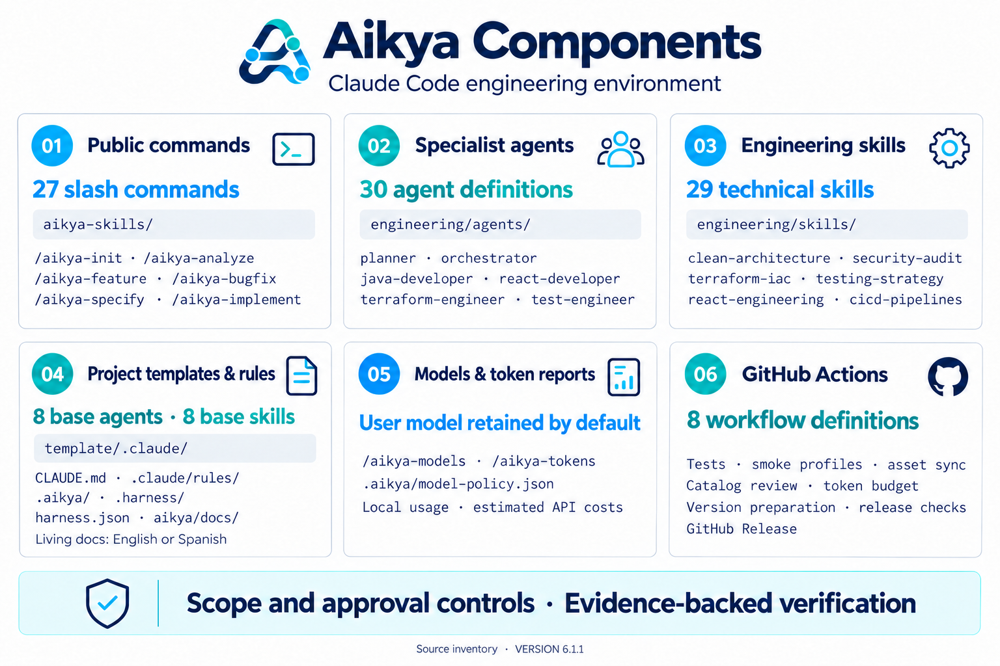
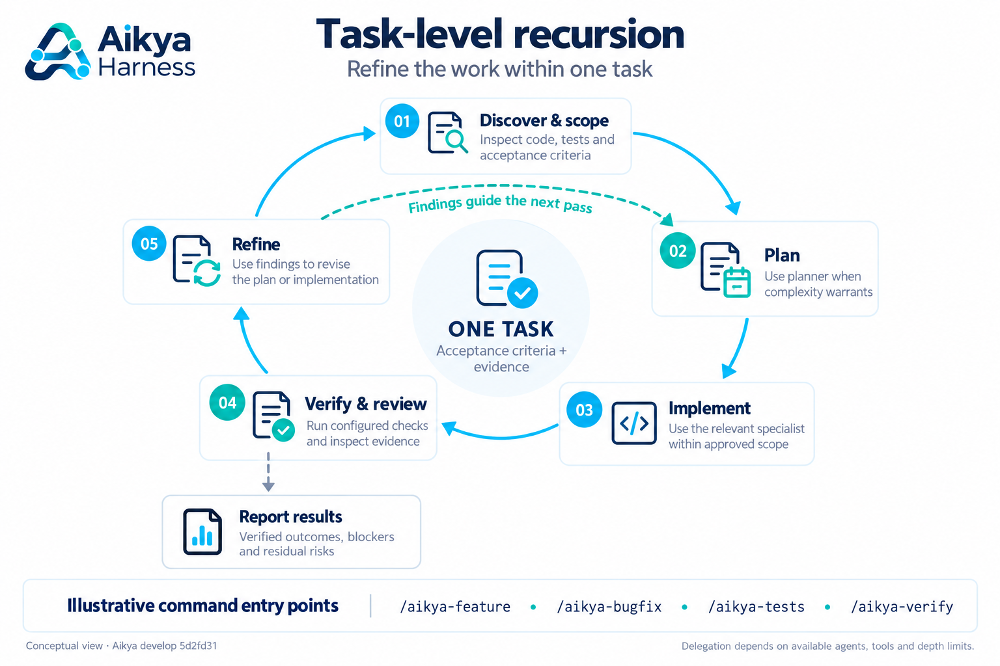
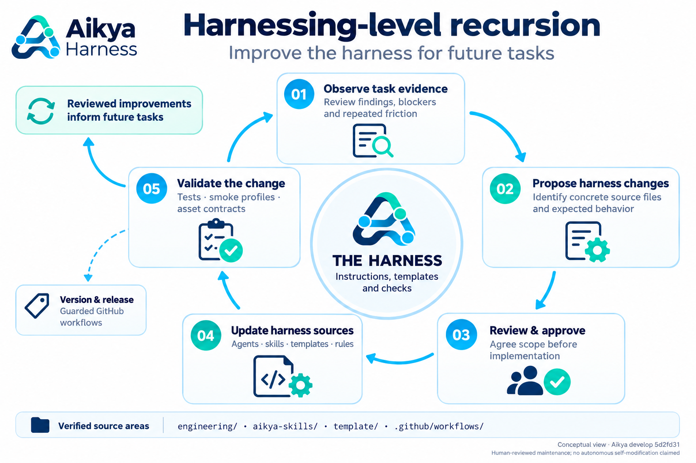
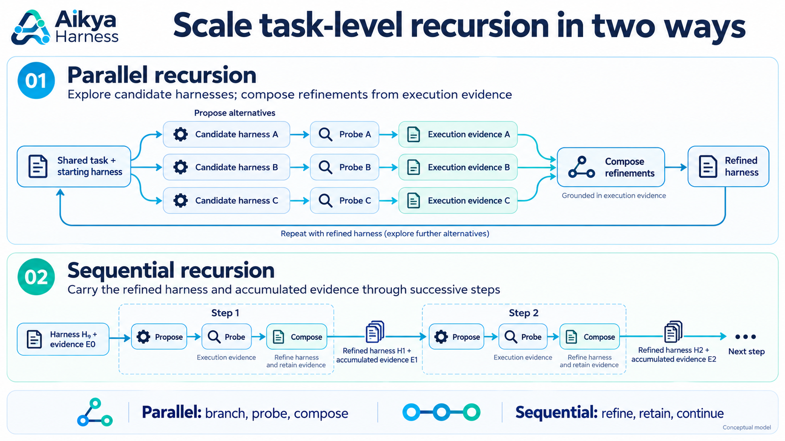

# Aikya Harness

[English](README.md) | [Español](README.es.md)

**Un flujo de ingeniería. Múltiples agentes de IA. Calidad consistente.**


Aikya Harness es un entorno de ingeniería para Claude Code que combina incorporación
segura de proyectos, generación de estructuras de aplicaciones, planificación de
infraestructura como código, subagentes especializados, Agent Skills, controles de
calidad, observabilidad y documentación viva.

Incluye soporte para backends Java, .NET, Node.js, Next.js y Python; frontends React,
Vue, Angular y Astro; aplicaciones Android, iOS, Flutter y React Native; y repositorios
independientes de infraestructura y DevOps.

**Todas las interacciones se inician desde Claude Code.** Aikya gestiona internamente
sus scripts de Python y solicita aprobación antes de escribir archivos, descargar
recursos de terceros, instalar SDK o realizar operaciones externas.

## 1. Inicio rápido

Abre Claude Code en el directorio de destino y pega:

```text
Instala Aikya Harness desde https://github.com/jlema0590/aikya-harness.git --scope global
```

> **Ámbito de instalación:** solicita `global` para tu usuario de Claude Code o `project` para el repositorio actual.
> Este bloque es una petición en lenguaje natural a Claude Code. El script interno de registro,
> `aikya_setup.py`, acepta `--scope global` o `--scope project`; `scope=global` no es un argumento de CLI.
> El ámbito de instalación es independiente de `/aikya-analyze --scope <relative-path>`, que selecciona el directorio que se analiza.

| Valor | Dónde se registra | Cuándo elegirlo |
|---|---|---|
| `global` | Para el usuario actual de Claude Code, con un entorno de ejecución compartido. Los proyectos se inicializan por separado. | Quieres disponer de los comandos de Aikya en distintos proyectos. |
| `project` | En el repositorio actual, con un entorno de ejecución local en `.aikya/runtime/`. | Quieres limitar el registro a un único repositorio. |

Inicia una nueva sesión de Claude Code y elige el comando de incorporación correspondiente.

## 2. Incorporación de proyectos

| Punto de partida | Comando | Funcionamiento |
|---|---|---|
| **Proyecto nuevo** | **`/aikya-init`** | Entrevista, decisiones técnicas e inicialización aprobada. |
| **Repositorio existente** | **`/aikya-analyze`** | Detección de tecnologías mediante evidencias del repositorio y vista previa de la incorporación. |

### Proyectos nuevos → `/aikya-init`

```text
/aikya-init
```

Utiliza un directorio de proyecto vacío. El comando selecciona siempre `mode=new`
y te guía por las decisiones necesarias. Si detecta código existente, utiliza `/aikya-analyze`.

| Tipo de proyecto | Opciones que se definen durante la incorporación |
|---|---|
| `development` | Tecnologías, estructura del repositorio, arquitectura, pruebas y soporte opcional de infraestructura o plataforma. |
| `infrastructure` | Terraform/OpenTofu, Ansible, proveedor, entornos y restricciones. |
| `devops` | Docker, imagen o código fuente, chart de Helm existente, Kubernetes y YAML/Kustomize. |

La entrevista también pregunta el idioma de la documentación viva. Revisa el plan
de archivos antes de aprobar los cambios. Después, comprueba los requisitos y
planifica la generación de la estructura:

```text
/aikya-doctor
/aikya-scaffold plan
```

Para infraestructura o DevOps, empieza con `/aikya-infra-project plan`.
Los generadores, las descargas y las operaciones externas requieren las aprobaciones correspondientes.

### Proyectos existentes → `/aikya-analyze`

Empieza con una vista previa de solo lectura:

```text
/aikya-analyze --dry-run --docs-lang en
```

Aikya detecta las tecnologías y la arquitectura existentes sin una entrevista técnica.
Presenta los cambios gestionados por Aikya antes de incorporarlos. Los repositorios
ambiguos devuelven `PARTIAL` o `NEEDS_REVIEW` y requieren revisión antes de continuar.

| Opción | Finalidad |
|---|---|
| `--dry-run` | Mostrar la detección y los cambios previstos sin instalar. |
| `--report-only` | Devolver un informe de análisis sin escribir archivos. |
| `--focus general` | Análisis general; enfoque predeterminado. |
| `--focus security` | Centrarse en evidencias de seguridad. |
| `--focus architecture` | Centrarse en evidencias de arquitectura. |
| `--focus infrastructure` | Centrarse en evidencias de infraestructura. |
| `--focus operations` | Centrarse en evidencias operativas. |
| `--scope <relative-path>` | Limitar la detección a un componente, como un espacio de trabajo de un monorepo. |
| `--refresh` | Actualizar únicamente los recursos de análisis cuya gestión por Aikya pueda verificarse. |
| `--docs-lang en` o `--docs-lang es` | Elegir el idioma de la documentación viva. |

Ejemplos: ejecuta cada uno por separado según lo necesites.

```text
/aikya-analyze --report-only --focus security
/aikya-analyze --dry-run --focus architecture --scope apps/api --docs-lang en
/aikya-analyze --refresh
```

La detección no compila aplicaciones, ejecuta scripts de la aplicación ni despliega
infraestructura. La incorporación conserva el código de la aplicación y las configuraciones personalizadas.

### Idioma de la documentación

`en` es el idioma predeterminado; también está disponible `es` **únicamente para
los documentos Markdown de documentación viva dentro de `aikya/docs/`**.
La preferencia se almacena en `.aikya/docs-policy.json`.
La política del proyecto mantiene en inglés los agentes, skills, reglas, código y
documentación fuera de ese directorio. Cambiar el idioma de documentación existente
requiere una migración revisada por separado.

## 3. Componentes y estructura del proyecto



### Código fuente del harness

| Ruta | Finalidad |
|---|---|
| `aikya-skills/` | Fuente de los 21 comandos públicos de Claude Code. |
| `engineering/agents/` | Definiciones del catálogo de agentes especialistas. |
| `engineering/skills/` | Catálogo de skills técnicas. |
| `template/` | Agentes base, skills, reglas y utilidades del harness para los proyectos. |

### Archivos y directorios del proyecto

| Ruta | Finalidad |
|---|---|
| `.aikya/answers.json` | Decisiones técnicas para perfiles compatibles. |
| `.aikya/docs-policy.json` | Idioma de la documentación viva. |
| `.aikya/model-policy.json` | Política opcional de modelos por rol. |
| `.aikya/analysis/` | Inventario basado en evidencias de repositorios existentes. |
| `.harness/project-profile.json` | Perfil técnico normalizado y compatible con versiones anteriores. |
| `.harness/engineering-catalog.json` | Procedencia de los agentes y skills gestionados. |
| `.claude/agents/` y `.claude/skills/` | Especialistas y capacidades seleccionados según las tecnologías reales. |
| `.claude/rules/` y `CLAUDE.md` | Contratos de ingeniería e instrucciones del proyecto. |
| `aikya/docs/` | Documentación viva y registros de cambios por petición. |
| `aikya/scripts/` y `aikya/test/` | Utilidades internas y pruebas del harness. |
| `harness.json` | Controles de calidad configurados y comportamiento de `NOT_CONFIGURED`. |

Los monorepos nuevos pueden organizar las aplicaciones bajo `apps/`, con `packages/`
y `contracts/` compartidos. Un repositorio de una sola aplicación la mantiene en la raíz.
Los proyectos existentes no se reorganizan automáticamente.

## 4. Comandos de Claude Code

| Comando | Finalidad |
|---|---|
| /aikya-init | Entrevistar e inicializar un proyecto nuevo |
| /aikya-analyze | Analizar e incorporar un repositorio existente |
| /aikya-answers | Aplicar un perfil técnico declarativo validado |
| /aikya-doctor | Diagnosticar localmente los requisitos de SDK y del entorno de ejecución |
| /aikya-project-init | Planificar un proyecto o módulo nuevo |
| /aikya-infra-project | Planificar, generar con aprobación y validar infraestructura |
| /aikya-scaffold | Planificar y ejecutar generadores de aplicaciones aprobados para proyectos nuevos |
| /aikya-feature | Implementar una funcionalidad de alcance definido con pruebas |
| /aikya-bugfix | Investigar errores y aportar evidencias de regresión |
| /aikya-architecture-review | Revisar la arquitectura y proponer ADR |
| /aikya-mobile-feature | Entregar funcionalidades móviles validadas |
| /aikya-skills-status | Consultar las Agent Skills registradas |
| /aikya-skills-plan | Evaluar las fuentes de skills externas y el impacto de su instalación |
| /aikya-skills-install | Instalar skills externas revisadas tras su aprobación |
| /aikya-quality | Ejecutar los controles de calidad disponibles |
| /aikya-docs | Mantener documentación viva respaldada por evidencias |
| /aikya-tests | Ejecutar pruebas específicas y de regresión |
| /aikya-documentation-sync | Sincronizar los documentos afectados y la trazabilidad por petición |
| /aikya-verify | Validar los cambios técnicos y sus resultados |
| /aikya-models | Revisar la política opcional de selección de modelos |
| /aikya-tokens | Consultar el consumo de tokens y los costes estimados de API |

Las skills locales del proyecto también incluyen flujos base de funcionalidades,
corrección de errores, verificación, documentación y revisión de arquitectura.
Las herramientas externas opcionales no deben invocarse automáticamente.

## 5. Documentación, auditorías e historial de Git


Los cambios técnicos relevantes actualizan las páginas `.md` afectadas de `aikya/docs/`
y crean un registro `changes/REQ-*.md` con **Cambios**, **Evidencias** y
**Documentos actualizados**. `docs_guard` comprueba los requisitos documentales.
Al incluirlos en los commits del proyecto, estos archivos aportan un historial y
diferencias revisables para auditorías y seguimiento de versiones.
Las consultas de solo lectura no requieren registros artificiales; no deben
registrarse prompts completos, secretos ni datos privados.

## 6. Agentes de ingeniería y Agent Skills

Aikya selecciona especialistas según las tecnologías reales: arquitectura, backend,
frontend, móvil, cloud, infraestructura, CI/CD, seguridad, pruebas y revisión de código.
**Planner** y **Orchestrator** ayudan con trabajos complejos que abarcan varias tecnologías
cuando es necesario. Los revisores actúan dentro de sus permisos y los especialistas
que modifican archivos respetan el alcance aprobado. Que un agente esté instalado no demuestra que se haya ejecutado.

### Skills externas opcionales

| Integración externa | Fuente registrada | Disponibilidad en Aikya |
|---|---|---|
| Ponytail | [DietrichGebert/ponytail](https://github.com/DietrichGebert/ponytail) | Opcional; incluida en el plan de integraciones externas. |
| Graphify CLI | [Graphify-Labs/graphify](https://github.com/Graphify-Labs/graphify) | Opcional; integración de CLI y skill del proyecto. |
| UI UX Pro Max | [nextlevelbuilder/ui-ux-pro-max-skill](https://github.com/nextlevelbuilder/ui-ux-pro-max-skill) | Opcional; incluida en el plan para perfiles frontend o móviles. |

Consulta la disponibilidad y el impacto de la instalación desde Claude Code:

```text
/aikya-skills-status
/aikya-skills-plan
```

Tras revisar el plan, utiliza `/aikya-skills-install` con aprobación explícita.
Antes de instalar, revisa la procedencia, licencia, herramientas, acceso a red y
versión o commit. Los hooks de instalación de terceros no deben ejecutarse de forma silenciosa.

### Recursión: vistas conceptuales del flujo de trabajo

Los siguientes diagramas explican dos niveles de mejora. Son vistas conceptuales
basadas en la revisión de tareas y el mantenimiento del harness; no representan
comandos adicionales de Aikya ni una capacidad de automodificación autónoma.

La **recursión a nivel de tarea (Task-level recursion)** mejora la implementación
dentro de una tarea a partir de los hallazgos de verificación y los criterios de aceptación.



La **recursión a nivel de harness (Harnessing-level recursion)** mejora los agentes,
skills, plantillas y reglas reutilizables mediante cambios revisados y validados
para tareas futuras.



El siguiente diagrama amplía el modelo conceptual: la **recursión paralela** explora
harnesses candidatos y combina mejoras a partir de evidencias de ejecución;
la **recursión secuencial** transmite el harness refinado y las evidencias acumuladas
a través de pasos sucesivos de **Proponer → Probar → Componer (Propose → Probe → Compose)**.
Son patrones explicativos, no modos de ejecución integrados verificados.



## 7. Nuestro enfoque de seguridad con Aikya

El flujo documentado de Aikya se centra en cambios de alcance definido,
aprobaciones explícitas y evidencias verificables:

- Conservar los archivos, agentes, skills e instrucciones personalizados del proyecto y proteger los secretos.
- Solicitar aprobación antes de instalar SDK, descargar dependencias y realizar operaciones externas.
- Exigir autorización independiente para despliegues, Terraform apply/destroy, escrituras en clústeres remotos y migraciones destructivas.
- Informar de los resultados reales: `PASS`, `FAIL`, `SKIPPED` y `NOT_CONFIGURED`.
- Distinguir los manifiestos y planes del estado verificado de la infraestructura en funcionamiento.
- Aplicar los requisitos documentales correspondientes y mantener la trazabilidad de los cambios.
- Revisar las fuentes externas opcionales antes de instalarlas y proteger las credenciales.

Estos controles orientan el comportamiento de Aikya; no certifican la seguridad
de una aplicación ni sustituyen la revisión de seguridad específica de cada proyecto.

## 8. Documentación adicional

- [Historial de cambios](CHANGELOG.md)
- [Guía de contribución](CONTRIBUTING.md)
- [Política de seguridad](SECURITY.md)
- [Código de conducta](CODE_OF_CONDUCT.md)
- [Separación entre init y analyze](docs/INIT_ANALYZE_SEPARATION.md)
- [Política de modelos y compatibilidad de v6](docs/V6_TOKEN_COMPATIBILITY.md)
- [Contratos de los workflows de GitHub](.github/workflows.md)
