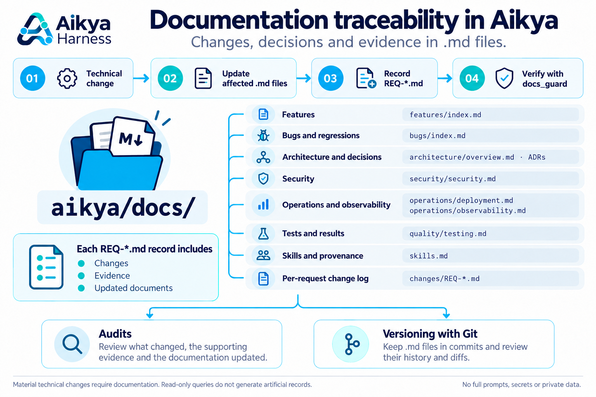

# Aikya Harness

[English](README.md) | [Español](README.es.md)

**One engineering workflow. Multiple AI agents. Consistent quality.**


Aikya Harness is a Claude Code engineering environment combining safe project
onboarding, application scaffolding, infrastructure-as-code planning, curated
subagents, Agent Skills, quality gates, observability and living documentation.

Supported stacks include Java, .NET, Node.js, Next.js and Python backends;
React, Vue, Angular and Astro frontends; Android, iOS, Flutter and React Native
applications; and standalone infrastructure and DevOps repositories.

**All interactions are initiated through Claude Code.** The harness maintains
its supporting Python scripts internally and requests approval before writes,
third-party downloads, SDK installation or external operations.

## 1. Quick start

Open Claude Code in your target directory and paste:

```text
Install Aikya Harness from https://github.com/jlema0590/aikya-harness.git --scope global
```

> **Installation scope:** request `global` for your Claude Code user, or `project` for the current repository.
> This block is a natural-language request to Claude Code. The internal registration script,
> `aikya_setup.py`, accepts `--scope global` or `--scope project`; `scope=global` is not a CLI argument.
> Installation scope is separate from `/aikya-analyze --scope <relative-path>`, which selects a directory to inspect.

| Value | Where it is registered | When to choose it |
|---|---|---|
| `global` | For the current Claude Code user, using a shared runtime. Projects are initialized separately. | You want Aikya commands available across your projects. |
| `project` | In the current repository, with a local runtime under `.aikya/runtime/`. | You want registration limited to one repository. |

Start a new Claude Code session, then choose the onboarding command below.

## 2. Onboarding

| Starting point | Command | How it works |
|---|---|---|
| **New project** | **`/aikya-init`** | Interview, technical decisions and approved initialization. |
| **Existing repository** | **`/aikya-analyze`** | Discover the stack from repository evidence and preview safe adoption. |

### New projects → `/aikya-init`

```text
/aikya-init
```

Use an empty project directory. The command always selects `mode=new` and guides
you through the required choices. If existing code is detected, use `/aikya-analyze`.

| Project type | Choices covered during onboarding |
|---|---|
| `development` | Stack, repository layout, architecture, testing and optional infrastructure/platform support. |
| `infrastructure` | Terraform/OpenTofu, Ansible, provider, environments and constraints. |
| `devops` | Docker, image/source, existing Helm chart, Kubernetes and YAML/Kustomize. |

The interview also asks for the living documentation language. Review the file
plan before approving changes. Then check prerequisites and plan scaffolding:

```text
/aikya-doctor
/aikya-scaffold plan
```

For infrastructure or DevOps generation, start with `/aikya-infra-project plan`.
Generators, downloads and external operations require their applicable approvals.

### Existing projects → `/aikya-analyze`

Start with a read-only preview:

```text
/aikya-analyze --dry-run --docs-lang en
```

Aikya detects the existing stack and architecture without a technical interview.
It previews Aikya-owned changes before adoption. Ambiguous repositories return
`PARTIAL` or `NEEDS_REVIEW` and require review before proceeding.

| Option | Purpose |
|---|---|
| `--dry-run` | Preview detection and planned changes without installing. |
| `--report-only` | Return an analysis report without writing artifacts. |
| `--focus general` | General analysis; the default focus. |
| `--focus security` | Focus on security evidence. |
| `--focus architecture` | Focus on architecture evidence. |
| `--focus infrastructure` | Focus on infrastructure evidence. |
| `--focus operations` | Focus on operational evidence. |
| `--scope <relative-path>` | Limit discovery to a component, such as a monorepo workspace. |
| `--refresh` | Refresh only verifiably managed analysis assets. |
| `--docs-lang en` or `--docs-lang es` | Choose the living documentation language. |

Examples—run each separately as needed:

```text
/aikya-analyze --report-only --focus security
/aikya-analyze --dry-run --focus architecture --scope apps/api --docs-lang en
/aikya-analyze --refresh
```

Discovery does not build applications, execute application scripts or deploy
infrastructure. Adoption preserves application code and customized configurations.

### Documentation language

`en` is the default; `es` is also available **only for living Markdown documents
under `aikya/docs/`**. The preference is stored in `.aikya/docs-policy.json`.
All agents, skills, rules, source and documentation outside that directory remain
in English. Changing an existing documentation language requires a separately
reviewed migration.

## 3. Components and project structure


### Harness source

| Path | Purpose |
|---|---|
| `aikya-skills/` | Source of the 21 public Claude Code slash commands. |
| `engineering/agents/` | Curated specialist agent definitions. |
| `engineering/skills/` | Curated technical skills. |
| `template/` | Base project agents, skills, rules and harness utilities. |

### Project artifacts

| Path | Purpose |
|---|---|
| `.aikya/answers.json` | Technical decisions for compatible profiles. |
| `.aikya/docs-policy.json` | Living documentation language. |
| `.aikya/model-policy.json` | Optional per-role model policy. |
| `.aikya/analysis/` | Evidence-based inventory for existing repositories. |
| `.harness/project-profile.json` | Normalized, legacy-compatible technical profile. |
| `.harness/engineering-catalog.json` | Managed skill and agent provenance. |
| `.claude/agents/` and `.claude/skills/` | Specialists and capabilities selected for the actual stack. |
| `.claude/rules/` and `CLAUDE.md` | Engineering contracts and project instructions. |
| `aikya/docs/` | Living documentation and per-request change records. |
| `aikya/scripts/` and `aikya/test/` | Internal harness utilities and tests. |
| `harness.json` | Configured quality checks and `NOT_CONFIGURED` behavior. |

New monorepos can plan application workspaces under `apps/`, with shared
`packages/` and `contracts/`. A singlerepo keeps its application at the root.
Existing projects are not reorganized automatically.

## 4. Claude Code commands

| Command | Purpose |
|---|---|
| /aikya-init | Interview and initialize a brand-new project |
| /aikya-analyze | Discover and adopt an existing repository |
| /aikya-answers | Apply a validated declarative technical profile |
| /aikya-doctor | Diagnose SDK and runtime prerequisites locally |
| /aikya-project-init | Plan a new project or module |
| /aikya-infra-project | Plan, generate with approval and validate infrastructure |
| /aikya-scaffold | Plan and execute approved application generators for new projects |
| /aikya-feature | Implement a scoped feature with tests |
| /aikya-bugfix | Investigate defects and add regression evidence |
| /aikya-architecture-review | Review architecture and propose ADRs |
| /aikya-mobile-feature | Deliver validated mobile features |
| /aikya-skills-status | Inspect registered Agent Skills |
| /aikya-skills-plan | Assess external skill sources and installation impact |
| /aikya-skills-install | Install reviewed external skills after approval |
| /aikya-quality | Run available quality gates |
| /aikya-docs | Maintain evidence-backed living documentation |
| /aikya-tests | Run focused and regression tests |
| /aikya-documentation-sync | Synchronize impacted docs and request traceability |
| /aikya-verify | Validate technical changes and results |
| /aikya-models | Review optional model routing policy |
| /aikya-tokens | Inspect token usage and estimated API costs |

The project-local skills architecture also includes base feature, bugfix,
verification, documentation and architecture-review workflows. Do not invoke
optional external tools automatically.

## 5. Documentation, audits and Git history



Material technical changes update the affected `.md` pages under `aikya/docs/`
and create a `changes/REQ-*.md` record with **Changes**, **Evidence** and
**Updated documents**. `docs_guard` checks documentation requirements.
When committed with the project, these files provide reviewable history and diffs
for audits and version tracking. Read-only consultations do not require artificial
records; full prompts, secrets and private data must not be recorded.

## 6. Engineering agents and Agent Skills

Aikya selects specialists according to the actual stack: architecture, backend,
frontend, mobile, cloud, infrastructure, CI/CD, security, testing and code review.
**Planner** and **Orchestrator** support complex cross-stack work when needed.
Reviewers operate within their defined permissions; modifying specialists stay
within the approved scope. An installed agent is not proof that it has run.

### Optional external skills

| External integration | Registered source | Availability in Aikya |
|---|---|---|
| Ponytail | [DietrichGebert/ponytail](https://github.com/DietrichGebert/ponytail) | Optional; included in the external integration plan. |
| Graphify CLI | [Graphify-Labs/graphify](https://github.com/Graphify-Labs/graphify) | Optional; CLI and project skill integration. |
| UI UX Pro Max | [nextlevelbuilder/ui-ux-pro-max-skill](https://github.com/nextlevelbuilder/ui-ux-pro-max-skill) | Optional; included in the plan for frontend or mobile profiles. |

Review availability and installation impact from Claude Code:

```text
/aikya-skills-status
/aikya-skills-plan
```

After reviewing the plan, use `/aikya-skills-install` with explicit approval.
Review source provenance, license, tools, network access and version/commit before
installation. Third-party installer hooks must not run silently.

### Recursion: conceptual workflow views

The following diagrams explain two levels of refinement. They are conceptual
views grounded in task review and harness maintenance, not additional Aikya
commands or a claim of autonomous self-modification.

**Task-level recursion** refines implementation within one task using verification
findings and acceptance criteria.


**Harnessing-level recursion** improves reusable agents, skills, templates and
rules through reviewed source changes and validation for future tasks.


The next diagram extends that conceptual model: **parallel recursion** explores
candidate harnesses and composes refinements from execution evidence;
**sequential recursion** carries the refined harness and accumulated evidence
through successive **Propose → Probe → Compose** steps. These are explanatory
patterns, not verified built-in execution modes.


## 7. Our safety approach with Aikya

Aikya's documented workflow centers on scoped changes, explicit approvals and
verifiable evidence:

- Preserve customized project files, agents, skills, instructions and secrets.
- Ask for approval before SDK installation, dependency downloads and external operations.
- Require separate authorization for deployments, Terraform apply/destroy, remote cluster writes and destructive migrations.
- Report actual `PASS`, `FAIL`, `SKIPPED` and `NOT_CONFIGURED` outcomes.
- Distinguish source manifests and plans from verified live infrastructure state.
- Enforce applicable documentation requirements and retain change traceability.
- Review optional third-party sources before installation and protect credentials.

These controls guide Aikya's behavior; they do not certify an application as
secure or replace project-specific security review.

## 8. Further documentation

- [Changelog](CHANGELOG.md)
- [Contribution guide](CONTRIBUTING.md)
- [Security policy](SECURITY.md)
- [Code of conduct](CODE_OF_CONDUCT.md)
- [Init/analyze separation](docs/INIT_ANALYZE_SEPARATION.md)
- [v6 model and compatibility policy](docs/V6_TOKEN_COMPATIBILITY.md)
- [GitHub workflow contracts](.github/workflows.md)
