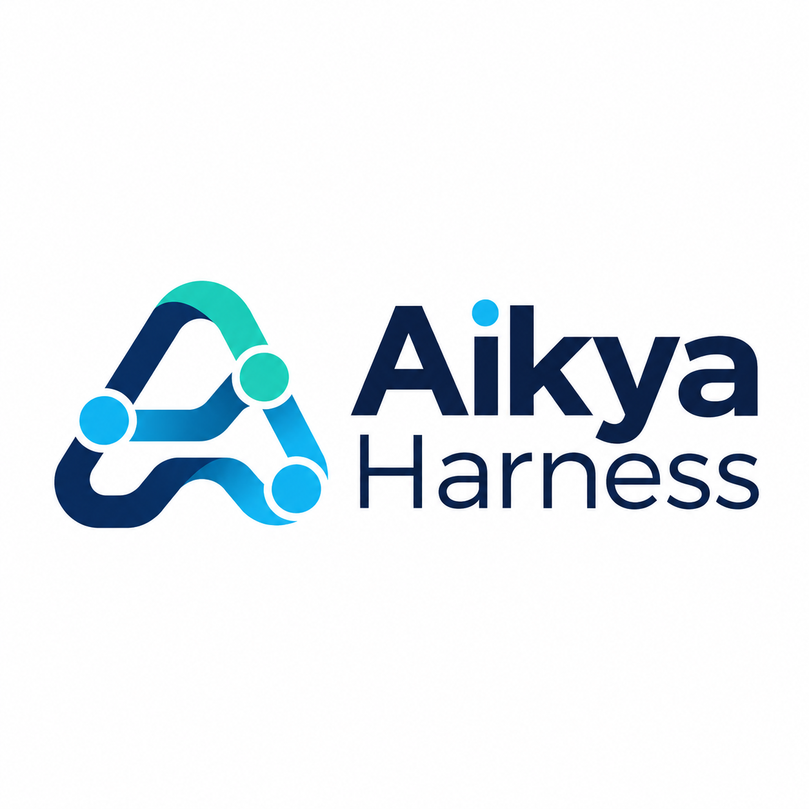

# Aikya Harness
**One engineering workflow. Multiple AI agents. Consistent quality.**



Aikya Harness es un entorno de ingeniería asistida por IA para **Claude Code**. Reúne entrevista técnica, scaffolding de aplicaciones, infraestructura como código, agentes especializados, Agent Skills, quality gates y documentación viva. Cubre backend Java, .NET, Node.js, Next.js y Python; frontend React, Vue, Angular y Astro; móvil Android, iOS, Flutter y React Native; y proyectos de infraestructura o DevOps sin aplicación.

> **Todo se inicia y se dirige desde Claude Code.** No necesitas ejecutar instaladores ni scripts en una terminal externa: Claude usa los scripts internos del repositorio y pide tu autorización antes de modificar el entorno o descargar dependencias.

## 1. Inicio rápido

1. Abre **Claude Code** en la carpeta donde quieras trabajar y envía:

   > **Instala Aikya Harness** desde `https://github.com/jlema0590/aikya-harness.git`, rama `develop`, en **modo global**. Revisa la fuente antes de instalar y pide mi aprobación para cualquier descarga o cambio de configuración. Registra sus skills, hooks y bienvenida, sin modificar otros repositorios ni instalar SDKs automáticamente. Después explícame cómo usar `/aikya-init`.

2. **Abre una sesión nueva** de Claude Code para que se carguen los comandos `/aikya-*` y el panel de bienvenida.
3. Ejecuta `/aikya-init` en el repositorio que quieras inicializar.

| Modo de instalación | Efecto |
|---|---|
| **Global** | Registra los comandos en el perfil de Claude Code del usuario y mantiene un runtime compartido. No inicializa ningún repositorio por sí solo. |
| **Proyecto** | Registra los comandos sólo en el repositorio actual, con runtime local en `.aikya/runtime/`. Sustituye «modo global» por «modo proyecto» en la petición. |

En ambos casos no se sobrescriben skills ni configuraciones personalizadas.

## 2. Tipos de proyecto

La **primera pregunta** de `/aikya-init` es el tipo de proyecto (`project_type`); después, si el repositorio es nuevo o existente (`mode`). Un perfil antiguo sin `project_type` se trata como `development`.

| Tipo | Qué pregunta | Qué genera |
|---|---|---|
| **Desarrollo** (`development`) | Stack, monorepo/singlerepo, arquitectura, calidad; infraestructura y DevOps opcionales | Aplicaciones, `aikya/` e infraestructura opcional |
| **Infraestructura** (`infrastructure`) | Terraform/OpenTofu y/o Ansible, cloud u on-premise, entornos y restricciones | `infra/terraform/` o `infra/ansible/`, sin `apps/`, `packages/` ni `contracts/` |
| **DevOps** (`devops`) | Origen (código, imagen, chart o manifests), Docker/Compose, destino y Kubernetes | Dockerfile sólo con código verificable, Compose desde imagen, YAML, Helm (nuevo o existente) o Kustomize |

**Flujo recomendado:**

```text
/aikya-init → /aikya-doctor → /aikya-scaffold plan → autorizar → /aikya-infra-project → /aikya-quality
```

- Claude pregunta sólo por las decisiones que faltan, guarda el perfil en `.aikya/answers.json` y muestra un resumen antes de aplicar cambios.
- `/aikya-doctor` valida JDK, .NET, Node.js, gestores de paquetes, Android SDK, Xcode, Flutter o las herramientas de infraestructura elegidas. **Si falta un requisito, el scaffold se detiene**; nunca se actualizan SDKs en silencio.
- Los modos Infraestructura y DevOps no ejecutan `/aikya-scaffold` ni generan tests de aplicación ficticios.
- En proyectos existentes Aikya amplía de forma incremental: no mueve aplicaciones ni ejecuta scaffolds destructivos.

## 3. Comandos de Claude Code

| Grupo | Comando | Qué hace | Ejemplo |
|---|---|---|---|
| Inicialización | `/aikya-init` | Entrevista técnica para proyecto nuevo o existente. | `/aikya-init Quiero una API Java 21 con React` |
| | `/aikya-answers` | Reutiliza un archivo de decisiones aprobado. | `/aikya-answers examples/next-react/answers.json` |
| | `/aikya-doctor` | Diagnostica SDKs y herramientas sin modificarlos. | `/aikya-doctor Revisa si tengo el SDK .NET adecuado` |
| | `/aikya-project-init` | Define alcance, estructura, roadmap y ADR inicial. | `/aikya-project-init Planifica una API de inventario` |
| Generación | `/aikya-scaffold` | Previsualiza y, con aprobación, ejecuta generadores oficiales por módulo. | `/aikya-scaffold Planifica backend .NET y frontend Vue` |
| | `/aikya-infra-project` | `plan`, `generate` y `validate` de contratos, infraestructura, CI y quality gates. | `/aikya-infra-project plan` |
| Desarrollo | `/aikya-feature` | Implementa funcionalidad con criterios de aceptación y pruebas. | `/aikya-feature Crea GET /health` |
| | `/aikya-bugfix` | Reproduce y corrige un error con prueba de regresión. | `/aikya-bugfix Corrige el error 401 del login` |
| | `/aikya-architecture-review` | Revisa límites de módulos, contratos y ADR. | `/aikya-architecture-review Revisa la división de servicios` |
| | `/aikya-mobile-feature` | Cambios Android/iOS con requisitos nativos. | `/aikya-mobile-feature Añade login biométrico en Android` |
| Calidad y docs | `/aikya-quality` | Quality gates, lint de skills y revisión documental. | `/aikya-quality Revisa el estado del proyecto` |
| | `/aikya-tests` | Pruebas focalizadas o de regresión según el stack. | `/aikya-tests Ejecuta los tests del módulo login` |
| | `/aikya-docs` | Actualiza la documentación afectada y la bitácora. | `/aikya-docs Documenta la autenticación JWT` |
| | `/aikya-documentation-sync`, `/aikya-verify` | Alias históricos, mantenidos por compatibilidad. | `/aikya-verify Comprueba la última feature` |
| Skills | `/aikya-skills-status` | Inventario de skills y agentes; sincroniza `aikya/docs/skills.md`. | `/aikya-skills-status` |
| | `/aikya-skills-plan` | Recomienda especialistas y skills externas para el stack. | `/aikya-skills-plan Analiza este proyecto Next.js` |
| | `/aikya-skills-install` | Instala con aprobación especialistas del catálogo o skills de GitHub. | `/aikya-skills-install Sólo Ponytail y Graphify` |

Los comandos se definen en `aikya-skills/` de este repositorio. Los proyectos inicializados incluyen también las skills originales sin prefijo por compatibilidad, y los comandos de desarrollo comprueban que el repositorio esté inicializado antes de actuar.

## 4. Estructura de un proyecto Aikya

Durante `/aikya-init` (modo Desarrollo) se elige la **topología del repositorio**, independiente de la arquitectura:

- **Monorepo:** `apps/`, `packages/` y `contracts/`. Necesario para varias aplicaciones (p. ej. Java + React, o Android + iOS).
- **Singlerepo:** una única aplicación **en la raíz**, sin carpetas de workspace. El scaffold genera en un directorio temporal y copia a la raíz sólo tras comprobar conflictos.

```text
aikya/
  docs/        # overview, roadmap, features, seguridad, ADR, skills.md, agents.md y changes/REQ-*.md
  test/        # pruebas del propio harness
  scripts/     # validaciones, ingeniería, scaffolding e infraestructura
.claude/       # agentes, skills, reglas y hooks de Claude Code
.aikya/        # respuestas de la entrevista y runtime local
.harness/      # perfil, estados y manifiestos internos (harness.json en la raíz)
apps/ infra/   # sólo si el stack lo requiere y se autoriza
```

## 5. Infraestructura y DevOps

Disponible como modo propio o como bloque opcional del modo Desarrollo: proveedor (AWS, Azure, GCP, on-premise, híbrido), Terraform/OpenTofu, Ansible, Docker/Compose, Kubernetes con **una sola** estrategia (Helm, Kustomize o YAML), entornos, imagen y puerto.

| Artefacto | Ubicación y condiciones |
|---|---|
| Terraform, Ansible, Helm, Kubernetes | `infra/terraform/`, `infra/ansible/`, `infra/helm/`, `infra/kubernetes/`, sólo si se seleccionan |
| `Dockerfile` y `.dockerignore` | Junto a la aplicación; requieren runtime, lockfile y comando de arranque reales |
| `compose.apps.yaml` | Servicios ya contenerizados para desarrollo local; no es un despliegue de producción |
| Plan y evidencias | `aikya/docs/infrastructure/` |

- **Helm existente:** `helm_chart_mode=existing` con `helm_chart_path` relativo. El chart no se modifica; se valida con `helm lint` y `helm template`.
- **Kubernetes desde imagen existente** no necesita Docker local, sólo el motor de validación elegido.
- `/aikya-infra-project plan` no modifica nada; `generate` pide aprobación explícita y crea sólo archivos inexistentes; `validate` ejecuta fmt, sintaxis Ansible, `compose config`, `helm lint` o `kustomize build` si las herramientas están disponibles.
- Una validación local no prueba la infraestructura desplegada. Lo que no se puede verificar (imagen sin versión, puerto o runtime) queda como **pendiente**.

## 6. Catálogo de agentes y skills técnicas

`engineering/agents/` contiene **27 subagentes** especializados y `engineering/skills/` **29 Agent Skills** con métodos y checklists. Al confirmar la entrevista, `engineering_catalog.py` copia sólo los que encajan con el stack y la arquitectura a `.claude/agents/` y `.claude/skills/` del proyecto. El resto queda en el catálogo local para activarlo más tarde con `/aikya-skills-install`, siempre con aprobación y sin descargas.

| Dominio | Agentes | Skills |
|---|---|---|
| Coordinación | `planner`, `orchestrator` | — |
| Calidad | `code-reviewer`, `test-engineer` | `code-review`, `testing-strategy`, `security-audit` |
| Arquitecturas | `clean-architecture-architect`, `layered-architecture-architect`, `monolith-architect`, `microservices-architect`, `event-driven-architect` | `clean-architecture`, `layered-architecture`, `modular-monolith-architecture`, `microservices-architecture`, `event-driven-architecture` |
| Backend | `java-developer`, `dotnet-developer`, `python-developer`, `node-backend-developer`, `nextjs-developer` | `java-engineering`, `dotnet-engineering`, `python-engineering`, `node-api-design`, `nextjs-architecture` |
| Frontend | `react-developer`, `vue-developer`, `angular-developer`, `astro-tailwind-developer` | `react-engineering`, `vue-architecture`, `angular-engineering`, `astro-performance` |
| Móvil | `kotlin-developer`, `flutter-developer` | `kotlin-engineering`, `flutter-architecture` |
| Cloud e IaC | `cloud-architect`, `terraform-engineer`, `ansible-engineer` | `cloud-architecture`, `cloud-security`, `finops-optimization`, `terraform-iac`, `ansible-automation` |
| Contenedores y entrega | `docker-developer`, `kubernetes-engineer`, `helm-engineer`, `cicd-engineer` | `docker-best-practices`, `kubernetes-operations`, `helm-deployment`, `kustomize-deployment`, `cicd-pipelines` |

**Reglas de selección:**
- La arquitectura es independiente del lenguaje: `java` + `architecture=clean` activa `java-developer` y `clean-architecture-architect`. Un perfil `hexagonal` no se convierte silenciosamente en `clean`.
- `event-driven` sólo se activa si aparece en `architecture_patterns`; no va implícito en microservicios.
- Los modos Infraestructura y DevOps cargan sólo especialistas de infraestructura, no de lenguajes.
- Python y Angular tienen scaffolding **asistido/manual** hasta acordar generadores y versiones.
- Los arquitectos trabajan en modo plan; los desarrolladores editan según permisos. Aikya conserva su propio `security-reviewer` de plantilla.

La inicialización registra lo instalado en `aikya/docs/agents.md`, `aikya/docs/skills.md` y `.harness/engineering-catalog.json`.

### Skills externas

Integración **optativa y supervisada** de [Ponytail](https://github.com/DietrichGebert/ponytail), [Graphify](https://github.com/Graphify-Labs/graphify) (CLI local, sin MCP) y [UI UX Pro Max](https://github.com/nextlevelbuilder/ui-ux-pro-max-skill) para interfaz. También puedes incorporar una skill de GitHub indicando URL HTTPS, carpeta, nombre y commit:

> `/aikya-skills-install Quiero incorporar una skill desde https://github.com/ORGANIZACION/REPOSITORIO.git. Revisa primero su SKILL.md y licencia, identifica la carpeta skills/NOMBRE, verifica el commit exacto, explícame los permisos y solicita mi aprobación antes de instalarla.`

Nada se descarga ni se indexa automáticamente al iniciar Claude Code, y Graphify se consulta con preguntas concretas, nunca volcando el grafo completo.

## 7. Seguridad y garantías

- **Sin acciones remotas sin aprobación específica:** ni instalación de SDKs o dependencias, ni Terraform apply/destroy, ni playbooks contra servidores, ni push de imágenes, ni `helm`/`kubectl` contra clústeres, ni despliegues.
- **Sin secretos en Git:** no se guardan credenciales ni estados de Terraform, y no se inventan recursos cloud, imágenes ni puertos.
- **Sin sobrescribir:** se conservan código, documentación, skills y configuraciones personalizadas; la generación sólo crea archivos inexistentes.
- **Evidencias honestas:** un check que no está configurado, falla o no se pudo ejecutar se informa como **NO VERIFICADO** o **FALLÓ**, nunca como aprobado. Que un agente o una skill estén registrados no demuestra que se hayan usado.
- **Documentación viva:** cada cambio técnico actualiza los documentos afectados de `aikya/docs/` y queda registrado en `aikya/docs/changes/REQ-*.md`; los hooks avisan si falta documentación antes de cerrar una tarea.

## 8. Ejemplos

Cada carpeta de `examples/` contiene `answers.json` (decisiones que valida Aikya) y un `README.md` con su uso desde Claude Code. Son escenarios **simulados**, no aplicaciones compiladas ni desplegadas.

| Ejemplo | Tipo |
|---|---|
| [Next.js + React](examples/next-react/README.md) | Desarrollo, nuevo |
| [Spring Boot + React con Clean Architecture](examples/java-react-clean/README.md) | Desarrollo, nuevo |
| [ASP.NET Core + Vue (monolito modular)](examples/dotnet-vue/README.md) | Desarrollo, nuevo |
| [Android nativo con Kotlin](examples/android-kotlin/README.md) | Desarrollo, nuevo |
| [FastAPI + Angular](examples/python-angular/README.md) | Desarrollo, nuevo |
| [NestJS + React, microservicios y eventos](examples/node-react-microservices/README.md) | Desarrollo, nuevo |
| [API Java existente](examples/existing-java-api/README.md) | Desarrollo, existente |
| [Next.js + Terraform + Helm](examples/next-react-terraform-helm/README.md) | Desarrollo con infraestructura |
| [Java/React + Ansible + Kustomize](examples/java-react-ansible-kustomize/README.md) | Desarrollo con infraestructura |
| [Sólo Terraform](examples/infra-terraform-only/README.md) | Infraestructura |
| [Sólo Ansible](examples/infra-ansible-only/README.md) | Infraestructura |
| [Docker Compose](examples/devops-docker-compose/README.md) | DevOps |
| [Helm con chart existente](examples/devops-helm-existing/README.md) | DevOps |
| [Kustomize](examples/devops-kustomize/README.md) | DevOps |

**Uso:** `/aikya-answers Usa las decisiones de examples/next-react/answers.json, enséñame primero el plan y valida requisitos antes de generar código.`

### Pantalla de bienvenida

El hook `SessionStart` muestra un panel con el nombre del desarrollador y el repositorio al abrir una **sesión nueva**; una instalación hecha en una sesión ya abierta no lo lanza retroactivamente. Si no aparece, pide a Claude que previsualice `welcome.py --preview` y compruebe el evento `SessionStart`.

## 9. Documentación adicional

- [Historial de versiones](CHANGELOG.md)
- [Auditoría del catálogo de ingeniería](docs/audits/ENGINEERING_AUDIT.md): procedencia, exclusiones y validaciones pendientes.
- [Auditoría de skills externas](docs/audits/SKILLS_AUDIT.md): compatibilidad con Agent Skills, carga progresiva y amenazas.
